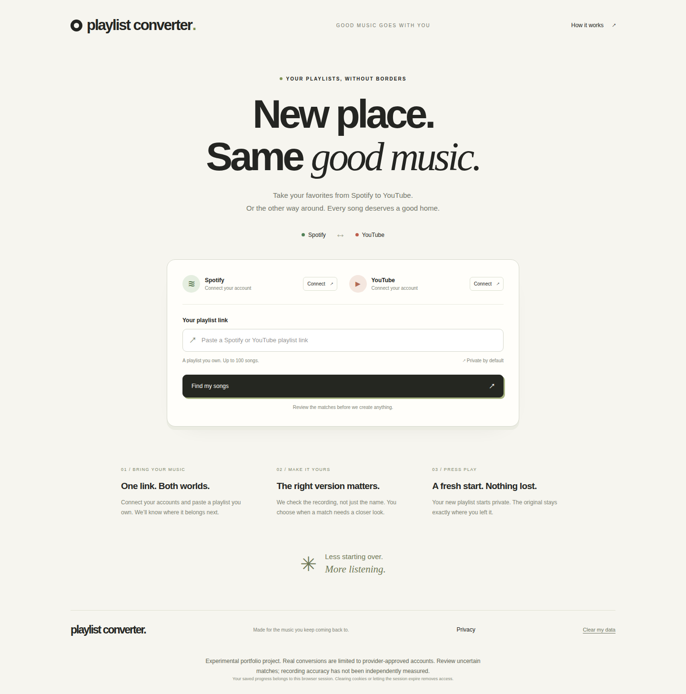
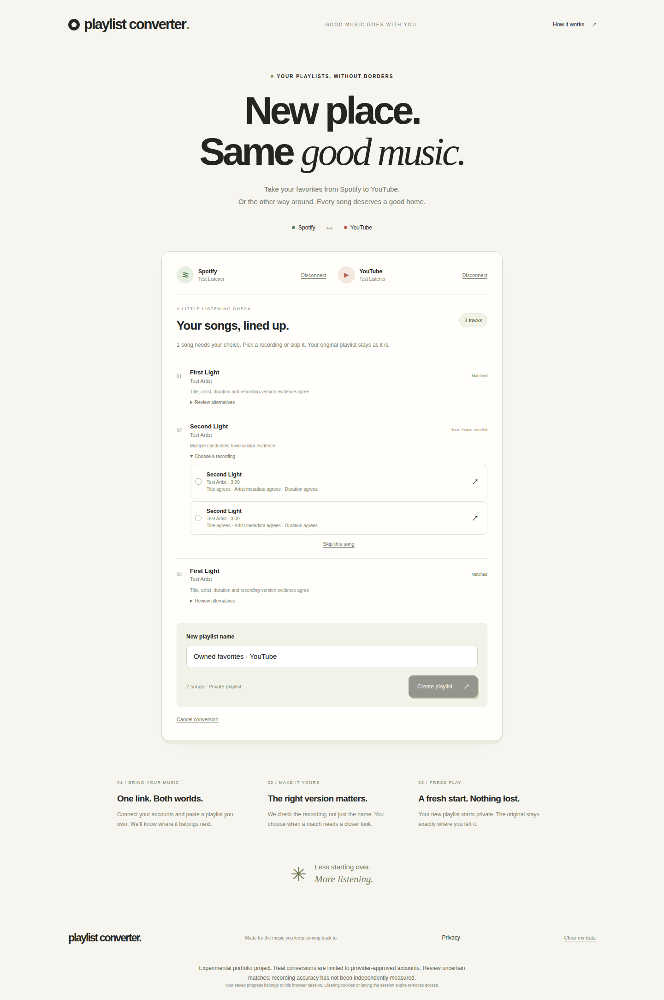
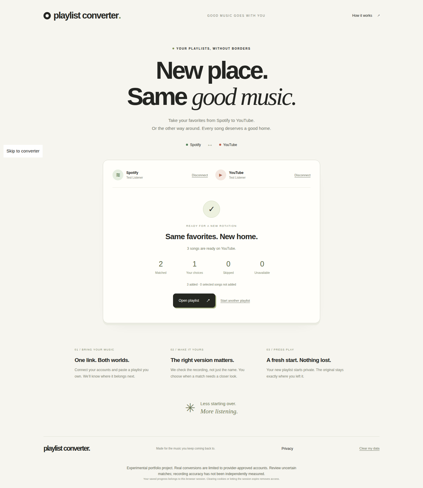

# Playlist Converter

Move an owned playlist between Spotify and YouTube, keeping its order and repeated songs. Review uncertain matches before creating a new private destination playlist.

A portfolio and learning project exploring Go, React, provider OAuth, conservative recording matching, and recovery from interrupted remote writes.

**Status:** experimental. Local tests use synthetic provider services. Real-account access and independently measured matching accuracy still require validation. The hosted instance is https://playlist-converter.jfs-cloud.com; conversions there only work for accounts approved in the provider apps while they remain in development mode. A public repository does not grant unrestricted Spotify/Google API access.



## Run locally without provider credentials

Requires Go 1.27.3, Node 24.22.2 and pnpm 12.11.2. With nvm installed:

```sh
nvm install
nvm use
npm install --global pnpm@12.11.2
go mod download
pnpm --dir web install --frozen-lockfile
go run ./cmd/testserver
```

In a second terminal at the project root:

```sh
nvm use
API_PROXY_TARGET=http://127.0.0.1:8081 pnpm --dir web dev --port 5173
```

Open **http://127.0.0.1:5173**, using that exact host to match OAuth origin validation. This mode uses disposable local data and simulated providers; it does not connect to your real music accounts. Fixture playlist URLs: see [development guide](docs/development.md).





## Real accounts and deployment

See [deployment](docs/deployment.md) to self-host on any Docker host behind an HTTPS reverse proxy: OAuth registration, persistent storage, trusted proxy configuration and online backups. Nothing is provisioned automatically by cloning this repository. Pushing a `v*` tag publishes the image to GHCR; deploying the maintainer's instance additionally requires an approved `production` environment and is not usable from forks.

## Quality checks

Stop manually started test servers before browser tests.

```sh
go test -race -coverprofile=coverage.out ./...
bash scripts/check-coverage.sh coverage.out 80
go vet ./...
pnpm --dir web typecheck
pnpm --dir web lint
pnpm --dir web format:check
pnpm --dir web exec vitest run --coverage
pnpm --dir web exec playwright install chromium
pnpm --dir web exec playwright test
pnpm --dir web build
go build ./cmd/server
bash scripts/workflow.test.sh
bash scripts/release-check.test.sh
bash scripts/release-check.sh
```

The release checker redacts findings and excludes local credentials/data. It is a heuristic plus inventory check, not proof that arbitrary secrets are absent; review the candidate files before publishing.

## Design and trade-offs

- React/TypeScript/Tailwind UI and Go HTTP API served from one origin.
- SQLite snapshots, publication intents, idempotency records and quota accounting.
- One process and serialized worker; no Redis or distributed queue.
- Meaningful recording variants are preserved. Ambiguous matches require review.
- After a timed-out write, inspect destination state before retrying. Uncertain results remain paused.

[Architecture](docs/architecture.md) · [Privacy](docs/privacy.md) · [Contributing](CONTRIBUTING.md) · [Security](SECURITY.md)

## Limitations

Owned playlists only; standard YouTube playlists, not guaranteed YouTube Music catalog equivalence. Default maximum 100 source occurrences. Provider allowlists, quotas and consent requirements apply. Browser sessions are not recoverable after cookie loss. No universal accuracy claim: synthetic matching fixtures cannot establish real-world precision.

Released under the [MIT license](LICENSE).
